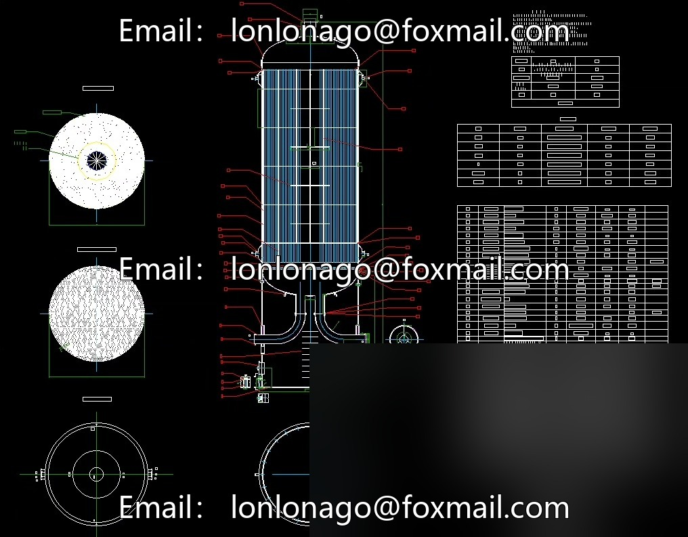
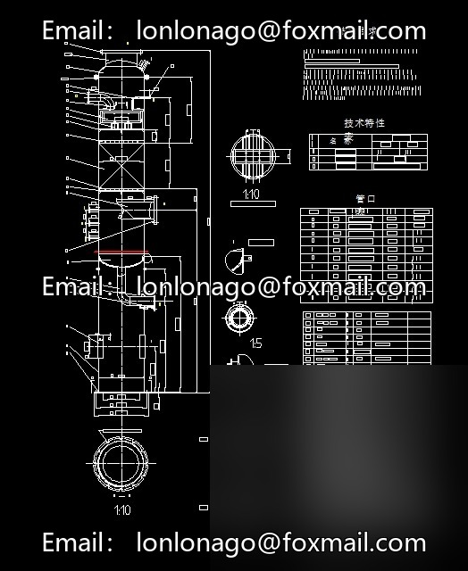
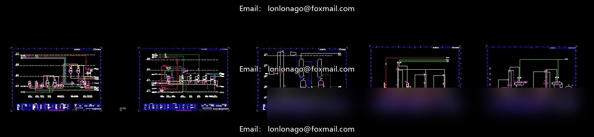
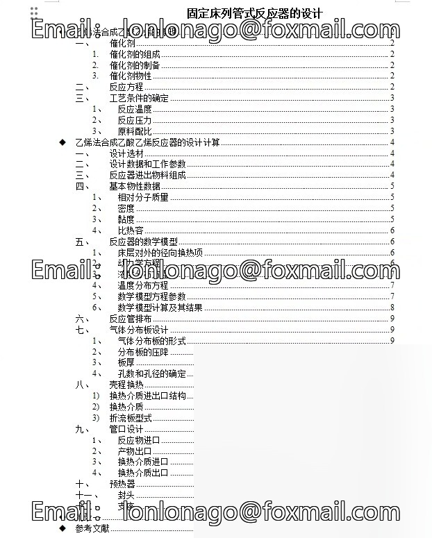
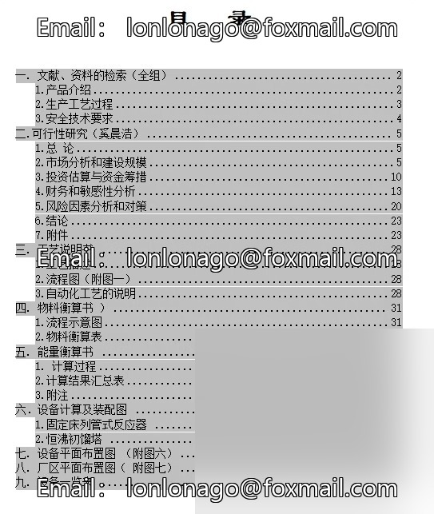

# Acetaldehyde vinyl preparation design, acetaldehyde vinyl factory design, acetaldehyde vinyl process design, acetaldehyde vinyl process design.

## Body

Acetaldehyde vinyl preparation design, acetaldehyde vinyl factory design, acetaldehyde vinyl process design, acetaldehyde vinyl drawing, acetaldehyde vinyl design drawing, acetaldehyde vinyl CAD drawing, acetaldehyde vinyl design CAD drawing
442 The design includes CAD drawings and instructions

The design covers acetic acid vinyl preparation, factory design and process design, including CAD drawings, instructions and related design materials.

<!-- AI_ENRICHED -->

## Images

## Payment

Here is a pay link on Stripe ( https://buy.stripe.com/3cs8yP7sY87d0vu9AB ). Please contact me lonlonago@foxmail.com after funding $89, and I will send you a complete data files , thank you!

